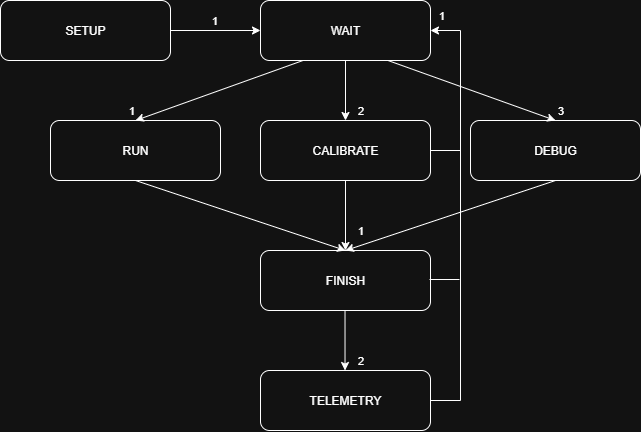

# Bally_OS - Firmware ESP32-S3

Este projeto implementa o controle de um robô baseado em ESP32-S3, utilizando arquitetura orientada a objetos, FreeRTOS e execução paralela em dois núcleos. A telemetria, os logs e os comandos trafegam via [BTP](https://github.com/AlisonTristao/BTP), e toda a comunicação (ESP-NOW, TCP, BLE ou USB serial, a chave, o terminal do TraceView e os tópicos) vem da [BTPDevice](https://github.com/AlisonTristao/BTPDevice).

> **Compatibilidade:**
> Este software está sendo desenvolvido para ser totalmente compatível com o hardware documentado no repositório [bally_robot](https://github.com/AlisonTristao/bally_robot).

> **Telemetria com T-Dongle S3 (LilyGO):**
> Para realizar a telemetria via ESP-NOW, é utilizado o T-Dongle S3 da LilyGO como receptor dos dados. O código desenvolvido para enviar comandos e logs do robô para o dongle está disponível em: [Bally_dongle](https://github.com/AlisonTristao/Bally_dongle).

## Estrutura do Projeto

```
├── include/       # Cabeçalho das definições globais necessárias para configurar o robô
├── lib/           # Bibliotecas principais (sensores, controle, motores, logger, etc.)
├── robot/         # Implementação dos estados da máquina de estados
├── src/           # Código principal (main.cpp)
│   └── btp/       # Configuração da BTPDevice: link, SD/chave, comandos, tópicos
├── utils/         # Objetos estáticos e utilitários globais
├── platformio.ini # Configuração do PlatformIO
```

### Principais Módulos

- **ArraySensor**: Gerencia o array de sensores frontais, incluindo calibração, leitura e normalização dos valores.
- **Encoder**: Gerencia a leitura dos encoders usando periféricos de hardware do ESP32.
- **Format**: Header-only, sem dependências — formatação de tamanhos em bytes (`"12.34 MB"`) reaproveitada por SDCard, USBMassStorage e Logger.
- **HBridge**: Controle dos motores via ponte H, incluindo direção e PWM.
- **BTPDevice** (componente ESP-IDF, checkout irmão `../BTPDevice`): o link (um por boot, escolhido pelo `comm_mode`), o nó BTP (sessão, manifesto, STATUS, assinaturas), a chave, o terminal do TraceView, o shell em task própria e a publicação dos tópicos. A configuração do robô fica em `src/btp/` — ver "Comunicação" abaixo.
- **Logger**: Ring de eventos em PSRAM; entrega cada linha à BTPDevice (`btpdev::log_record`, mensagens LOG com o horário original) e grava arquivos `.blog` no SD.
- **OTAUpdater**: Atualização de firmware sem fio a partir do estado DEBUG — conecta a uma rede Wi-Fi cadastrada no cartão SD, anuncia `<hostname>.local` via mDNS e recebe o novo binário via HTTP (`POST /update`). `GET /status` (JSON: `device`, `online`, `firmware`, `ota_ready`) deixa uma ferramenta externa checar se o robô está pronto para receber o upload antes de mandá-lo.
- **RobotSettings**: Armazena e persiste (`settings.conf` no SD) todos os parâmetros configuráveis em runtime. `settings -set` só muda a memória; `settings -apply <module>` empurra a mudança para o subsistema que já a consumiu no boot, sem reiniciar — ver "Aplicar configuração sem reboot" abaixo.
- **SDCard** / **USBMassStorage**: Acesso ao cartão SD e transferência de propriedade exclusiva do FAT entre o robô e um host USB.
- **StateMachine**: Máquina de estados do robô, com transições e *callbacks* configuráveis. Além do estado atual, guarda pedido de transição (`state -set`), trava (`state -lock`) e um anel com as últimas 8 transições.
- **JobScheduler**: Comandos de shell disparados por tempo (`every`/`once`) ou por entrada em estado (`at`). C++ puro, sem FreeRTOS/SD/TinyShell — o relógio chega por parâmetro e a execução por *callback*, o que deixa a lib inteira coberta por `test/test_job_scheduler` no `env:native`. Um *job* é agendamento, não garantia de entrega: ocorrência que não coube na fila é contada e descartada, e atraso maior que um intervalo inteiro é descartado em vez de virar rajada.
- **SystemMonitor**: Saúde do sistema (CPU, memória, temperatura, uptime, carga e *stack* por task). Sempre compilado. O único caminho periódico é o tópico `system.monitor`: só monta e transmite o relatório completo do `sys -health` (banner + CPU + memória + tabela de tasks, o mesmo texto do console) quando há uma assinatura ativa (por exemplo, o widget Quadro de Texto do TraceView), com teto de 1 Hz e corte por linha se a tabela de tasks estourar o limite de bytes. Os comandos `sysmon`/`sys` continuam disponíveis sob demanda.
- **StaticObjects**: Inicializa e centraliza instâncias globais dos principais objetos (robô, sensores, motores, logger, etc.).
- **TinyShell**: Interpretador de linha de comando embarcado. Organiza comandos em módulos, suporta autocompletar (*auto-completion*), converte dinamicamente os tipos de argumentos de *strings* para os tipos esperados, valida a execução e lida com erros de forma segura (*try-catch*).

### Comandos agendados e script de boot

Além de executar comandos digitados, o módulo `job` agenda linhas do próprio shell:

```
job -every 5000, sensor -position          # a cada 5 s, para sempre
job -repeat 200, 10, kalman -state         # 10 vezes, a cada 200 ms
job -once 3000, junkebox -play_builtin boot
job -at WAIT, sensor -calibrate            # a cada ENTRADA em WAIT
job -list / job -cancel <id> / job -cancel_all / job -stats
```

O comando agendado viaja como um único argumento e pode conter espaços; vírgulas dentro dele são escapadas com `\,` (o TinyShell separa argumentos em vírgulas não escapadas):

```
job -every 1000, robot -set_pwm_pair 40\, 40\, 500
```

Um arquivo de comandos no cartão roda com `job -run_file <path>`, e o arquivo `autoexec.job` na raiz roda sozinho no boot — é o que permite configurar o robô sem ninguém do outro lado. Linhas em branco e começadas por `#` são ignoradas; uma linha por passagem do `routine()`, o que impede um script longo de estourar a fila de 10 comandos.

Duas recusas deliberadas: **um job não agenda jobs** e **um script não roda comandos `job`** — as duas coisas se auto-replicam sem limite e encheriam as 8 vagas em poucas passagens.

### Aplicar configuração sem reboot

`settings -set` muda só a cópia em memória. `settings -apply <module>` é o pedaço de código que empurra esses valores para o subsistema que já os consumiu na inicialização, sem precisar de reboot.

```
settings -set ekf_noise gyro_noise 0.01
settings -apply ekf_noise      # reconstrói o filtro agora, sem reboot
settings -apply_all            # roda todo aplicador registrado
settings -diff                 # o que difere entre memória e settings.conf
```

`RobotSettings` continua sem depender de nenhum outro módulo (ver a regra de acoplamento acima): quem sabe aplicar um módulo se registra nela via `register_applier`, ela não conhece EKF, OTA ou Logger por si.

Nem todo módulo pode ser aplicado em runtime, e `settings -apply` diz honestamente qual é o caso:

| Módulo | O que acontece em `settings -apply` |
|---|---|
| `timers` | Reinicia o timer do EKF com o novo `sample_micros` (`esp_timer_restart`, sem perder a periodicidade) e aplica `timezone` via `setenv`/`tzset` na hora, sem esperar o próximo `logger -set_datetime`. |
| `logger` | `set_flush_limits(max_chunks_per_flush, block_size)`. |
| `ota` | `OTAUpdater::configure()` de novo — muda os tempos, o *hostname* mDNS e a senha. **Não** move o canal ESP-NOW que já está no ar: `espnow_channel` aqui só muda para onde o `ota -cancel` restaura o rádio depois. |
| `ekf_noise` | Reconstrói o filtro inteiro (`Q`/`R` são `const` para a vida do `TinyEKF`), com a task do EKF suspensa durante a janela — é a única reconstrução deste tipo no firmware, documentada como tal. |
| `kinematics`, `error` | Não fazem nada: `encoder_ppr`/`wheel_radius`/`error_blink_ms` são lidos direto de `settings.data()` a cada uso, sem cópia para atualizar. Registrados como *no-op* só para a resposta ser "applied" em vez de "requires a reboot". |
| `sensor`, `pins_*` (7 grupos) | **Sem aplicador**: `settings -apply` responde `requires a reboot`. `ArraySensor` reconfigura ADC/GPIO no construtor e os grupos de pino dimensionam periféricos já energizados — não há caminho de reconfiguração viva para nenhum dos dois. |

`settings -revision` conta quantas vezes `save()` gravou o arquivo com sucesso **nesta sessão de boot** (zera a cada reboot, `load()` não mexe nele). É a forma barata de um cliente remoto perceber "a configuração mudou desde a última vez que eu olhei", sem reler as ~55 chaves de `settings -list_all` para comparar. Deliberadamente **não** é a mesma coisa que o `config_revision` do manifesto: aquele campo do protocolo (BTP/docs/commands.md seção 3) documenta "o catálogo de tópicos/schemas mudou", que a BTPDevice deriva do próprio catálogo — reaproveitá-lo para outra coisa seria mudar unilateralmente a semântica de um campo do protocolo, a mesma classe de problema que `include/bally_channels.h` existe para evitar entre os três repositórios.

### Descoberta e diagnóstico

`sys -manifest` lista todo módulo e comando que o shell deste firmware conhece, para um cliente novo descobrir o catálogo em vez de embarcar uma lista copiada à mão que desatualiza. Construído em cima de `TinyShell::complete_line()` — a única introspecção **pública** que a biblioteca vendorizada expõe (`get_help()` e `get_expected_types()` são privados). Por isso o manifesto lista só nomes de módulo/comando, sem descrição nem tipo de argumento; combine com `help -complete` durante a digitação para o resto.

`sys -time_sync` sincroniza o relógio por SNTP (`pool.ntp.org`) **enquanto o OTA estiver conectado a uma rede Wi-Fi** — é a única rota deste firmware até um servidor NTP, já que o ESP-NOW não tem caminho até a internet. O horário sincronizado **não sobrevive a um reboot**: esta placa não tem RTC com bateria (ver o pinout em `include/Settings.h`), então cada boot começa do zero e precisa da sua própria sincronização.

Um `esp_register_shutdown_handler()` grava o *ring* de PSRAM retido no cartão antes de todo reboot **ordenado** (`sys -reboot`, `factory_reset`, o restart pós-upload do OTA) — mesmo raciocínio que já existia só para a transição TELEMETRY: o que ainda não saiu pelo rádio (possivelmente sem alcance) seria perdido quando o *ring* é limpo. **Isso não cobre uma queda (panic/abort)** — `esp_restart()` pula os *shutdown handlers* nesse caso, e cobrir essa metade exigiria uma partição de coredump, que este firmware ainda não tem (ver "Limitações conhecidas" abaixo).

### Comunicação (BTPDevice)

A comunicação inteira é da [BTPDevice](https://github.com/AlisonTristao/BTPDevice), configurada por quatro arquivos em `src/btp/`:

| Arquivo | O quê |
|---|---|
| `btp_device.cpp` | Nome (`settings.conf`, `identity.name`), link, canal ESP-NOW, MAC da dongle (`MAC_ADDR`), task de comunicação, `source_info` do manifesto |
| `btp_storage.cpp` | O SD do robô como volume da aplicação: `bally.key` e `wifi.txt` são lidos dali |
| `btp_commands.cpp` | Os módulos de shell do robô (`ROBOT::registerShell`) e o `state` |
| `btp_topics.cpp` | Os tópicos (`protocol.test`, `robot.state`, `system.monitor`, `robot.sensors`, `robot.flags`, ids `0x0001`..`0x0005`) |

- **Link:** `comm_mode` 0 ESP-NOW (dongle), 1 TCP (Wi-Fi do `wifi.txt`, porta 44300, `<nome>.local`), 2 BLE, 3 USB serial. Um boot em OTA (botão) usa TCP, porque o servidor de update anda na conexão Wi-Fi da BTPDevice.
- **Chave:** `bally.key` (gerado por `tools/provision_key.py` da BTPDevice) na raiz do SD é importado para o NVS no boot e renomeado para `bally.key.imported`; dali em diante a chave vive no NVS, com ou sem cartão. `btp -key` mostra as tags públicas. ESP-NOW, TCP e BLE são sempre cifrados (sem chave, a BTPDevice cai para o USB serial); o USB serial fica sem cifra, porque quem está no cabo já tem o robô na mão.
- **Canais:** no ESP-NOW a BTPDevice sela cada mensagem com a chave do canal (E para o TraceView através da dongle, L para a própria dongle) e responde pelo canal do pedido, conforme `include/bally_channels.h`.
- **Diagnóstico:** o módulo `btp` substitui os antigos `link`, `telemetry` e `sec`: `btp -status`, `btp -errors`, `btp -topics`, `btp -key`, `btp -link`, `btp -wifi`, `btp -fs`.
- **Telemetria:** as amostras são montadas na task de comunicação da BTPDevice, só na taxa assinada, a partir de snapshots do robô. Correntes e array sensor são lidos pela task da máquina de estados (a mesma que usa o mux no RUN) e só enquanto `robot.sensors` tem assinante.
- **Logs:** `Logger` entrega as linhas retidas à BTPDevice, que as manda como LOG para o painel do TraceView; linha recusada (sem peer, fila cheia) fica na PSRAM para a próxima passada. Enquanto um comando roda, suas linhas também são a saída dele no terminal.

`ota -scan` dispara uma varredura Wi-Fi de redes visíveis sem exigir nenhuma rede já cadastrada (ao contrário de `ota -start`, que precisa de pelo menos uma); `ota -scan_results` lista o que a última varredura viu (SSID, RSSI, aberta ou não). `job -save` grava todo job `every`/`at` ativo em `jobs.conf`, restaurado automaticamente no próximo boot (depois de `autoexec.job`); um job `once` nunca é salvo, porque seu atraso é relativo ao momento em que foi agendado — persisti-lo faria a mesma linha significar outra coisa depois de um reboot.

### Limitações conhecidas

- **Sem política de autorização por canal (READ/CONFIG/ACT).** A chave L (canal C, dongle) só administra o link — não é uma chave "de administrador geral" — mas os dois canais têm acesso igual: qualquer requisição selada com **qualquer uma** das duas chaves executa qualquer comando, motores inclusive.
- **Sem coredump em flash.** Não há partição dedicada em `partitions.csv`; uma queda (panic/abort) não deixa coredump para inspeção.

### Outras Pastas
- **robot/**: Implementação dos estados (Setup, Wait, Calibrate, Debug, Run, Finish, Telemetry, Error).
- **include/**: Definições globais necessárias para configurar o robô.
- **utils/**: Contém as configurações globais das funcionalidades do robô, centralizadas no objeto `ROBOT`, que permite criar apenas uma instância. Esse objeto unifica o acesso aos sensores, motores, utilidades dos sensores, logger, controle e demais recursos.

### Organização e Acoplamento entre Módulos

Cada pasta em `lib/` é compilável e compreensível isoladamente. Duas regras mantêm isso:

1. **Dependência entre bibliotecas só quando justificada, e sempre explícita.** A maioria dos módulos (`Flags`, `StateMachine`, `HBridge`, `Encoder`, `ArraySensor`, `SystemMonitor`, `Format`) não inclui nenhuma outra biblioteca do projeto. Onde uma dependência é real — `Logger` grava no `SDCard`; `OTAUpdater` usa `SDCard`/`Flags_out`; `USBMassStorage` usa `SDCard` — o header só faz `class Nome;` (forward declaration) e o `.cpp` inclui o header completo. Isso limita o acoplamento à implementação, não à interface pública: quem só usa a classe por referência/ponteiro nunca precisa saber o que ela inclui por baixo.
2. **`RobotSettings` não depende de nenhum outro módulo do projeto.** É a camada mais "de baixo" da configuração em runtime (dados + persistência em `settings.conf`); quem lê valores dela (`OTAUpdater`, `ArraySensor`, `Logger`, ...) depende dela, nunca o contrário. Os valores padrão compartilhados com o `OTAUpdater` (tempos, canal do ESP-NOW, ...) vivem em `lib/OTAUpdater/OtaDefaults.h`, um header sem nenhuma dependência que os dois incluem.

**Comandos de shell: cada módulo registra os próprios.** Toda classe que expõe comandos de shell implementa `register_shell_commands(TinyShell&, ...)` no seu próprio `.cpp`, recebendo por parâmetro só o que precisa (ex.: `OTAUpdater::register_shell_commands` recebe `Logger&`, `SDCard&`, `USBMassStorage&` e um `std::function<bool()>` para consultar se algum teste de DEBUG está ativo — sem precisar saber que "teste de DEBUG" é um conceito do `ROBOT`). `ROBOT::startWrappers()` (`utils/BallyRobot/BallyRobotShell.cpp`) é só a lista dessas chamadas de composição.

Alguns módulos de shell moram no próprio `ROBOT` (`registerSystemCommands`/`registerRobotIOCommands`/`registerKalmanCommands`/`registerDebugCommands`, em `utils/BallyRobot/BallyRobotShell.cpp`), por não terem dono natural fora dele:
- **`robot`** (btn/ssr/set_pwm/set_led): aciona os `Flags_in`/`Flags_out`/`Flags_pwm` que o próprio `ROBOT` compõe; não há uma biblioteca "dona" além dele.
- **`kalman`** (estado do EKF + log periódico): o filtro (`TinyEKF`) é uma dependência externa vendorizada, sem wrapper próprio no `lib/`; quem possui a instância, o timer de amostragem e os vetores de controle/medição é o `ROBOT`.
- **`debug`** (`test_arr_sensor`/`test_encoder`): o agendamento e o *gate* (estado DEBUG + USB ocioso) são aplicados uniformemente sobre vários sensores a partir de estado privado do `ROBOT`, não pertencem a nenhum sensor individual.
- **`sys`** (identidade, saúde e ciclo de vida): cruza `esp_system`, `esp_ota_ops`, a identidade BTP, `SystemMonitor` e `StateMachine` de uma vez; nenhuma lib isolada responde "quem sou eu e como estou".
- **`job`** (comandos agendados + script do SD): o `JobScheduler` é propositalmente livre de TinyShell para ser testável no host, e o executor de script precisa do cartão SD, que é do `ROBOT`; as linhas rodam no shell da BTPDevice (`BtpDevice::run()`).

Sobre `motion`: o `drive` recebe **comando normalizado (-100..100), não m/s**. Este firmware não tem modelo de motor calibrado — `EKF_K_R`/`EKF_K_L` são 1.0 de placeholder e `control_input[]` é PWM cru (ver `sampleEKF`), então converter metro por segundo em duty seria unidade inventada. A mistura diferencial é real; só a escala não é calibrada, e `motion -limits` diz isso no output.

`motion -disarm` é aplicado dentro do `setOutputs()`, não só onde o comando é aceito: enquanto desarmado a saída é zero a cada passagem, esteja o que estiver nas flags de PWM. É o que faz dele chave geral em vez de pedido educado. Nasce armado, para não mudar o fluxo de bancada.

`motion -coast` precisa de um *latch* porque o `setOutputs()` reaplica as flags a cada passagem e `HBridge::applyPWM(0)` é **freio ativo** — um `coast()` solto seria desfeito em menos de um milissegundo. Qualquer PWM comandado vence o coast pendente.

Além disso, `BallyRobotShell.cpp` é **o único lugar** onde podem ser registrados comandos que operam sobre as bibliotecas compiladas pelo `env:native` (`Format`, `JobScheduler`): nenhuma delas pode incluir `TinyShell.h`, que não existe no build de host. Ver `CONTRIBUTING.md` e o comentário de cabeçalho do próprio arquivo.

`ROBOT`/`BallyRobot` é o *composition root*: o único lugar que conhece e instancia todos os subsistemas. Ele não contém a lógica de negócio de nenhum deles.

## Fluxo Detalhado do Sistema

### Tasks da aplicação

O BallyOS cria cinco tasks próprias, e a BTPDevice mais duas. As do robô usam
`xTaskCreateStaticPinnedToCore()`, com stack e `StaticTask_t` reservados
estaticamente em `src/main.cpp`. O tick do FreeRTOS está configurado em 1 kHz;
portanto, nos loops que usam `WDOG_TIMEOUT_TK = 1`, o intervalo nominal entre
passagens é de 1 ms.

| Task | Core | Prioridade | Stack | Responsabilidade e forma de espera |
|---|---:|---:|---:|---|
| `state_machine` | 1 (`APP_CPU_NUM`) | 10 | 8 KB | Executa `StateMachine::run()`, roda a ação do estado atual, avisa a troca de estado (`robot.state`) e amostra correntes/array enquanto `robot.sensors` tem assinante. Faz `vTaskDelay(1)` ao final de cada passagem. |
| `btpdev_comms` (BTPDevice) | 0 (`PRO_CPU_NUM`) | 4 | 8 KB | O link: recepção, sessão, terminal, STATUS, tópicos (os `fill()` de `src/btp/btp_topics.cpp`) e logs. Acordada pelo link ou a cada 1 ms. |
| `EKF_task` | 0 (`PRO_CPU_NUM`) | 4 | 2 KB | Aguarda indefinidamente em `ulTaskNotifyTake()` e, quando notificada pelo timer, executa `predict()` e `update()`. |
| `routine` | 0 (`PRO_CPU_NUM`) | 3 | 8 KB | Processa o OTA, entrega os logs retidos à BTPDevice, atualiza flags/saídas, verifica transições, aciona sons e processa jobs e scripts. Faz `vTaskDelay(1)`. |
| `btpdev_shell` (BTPDevice) | qualquer | 3 | 8 KB | Executa, um por vez, os comandos do terminal, de `COMMAND_REQUEST` e dos jobs/scripts. |
| `junkebox_task` | 0 (`PRO_CPU_NUM`) | 1 | 4 KB | Fica bloqueada na mailbox de reprodução e usa task notifications para interromper uma nota em andamento. |
| `interrupts` | 0 (`PRO_CPU_NUM`) | 0 | 2 KB | Task de inicialização: registra as GPIO ISRs e cria o timer periódico do EKF; depois executa `vTaskDelete(NULL)`. |

`app_main` é a task de bootstrap criada pelo ESP-IDF. Ela inicializa o `ROBOT`,
inicia a BTPDevice (`start_device()`), liga os callbacks, cria as tasks acima e
então também se apaga. Existem ainda contextos pertencentes ao ESP-IDF: os
callbacks dos links executam nas tasks do Wi-Fi/NimBLE/TinyUSB e só copiam
bytes para a fila da BTPDevice, as GPIO ISRs executam em contexto de
interrupção e `sampleEKF()` executa na `ESP_TIMER_TASK`.

### Fluxo entre tasks, filas e callbacks

```text
GPIO ISR ─────────> Flags ──────────> routine ──> StateMachine::next()

link (ESP-NOW/TCP/BLE/USB) ──> btpdev_comms ──> btpdev_shell ──> resultado/terminal
routine (jobs, scripts) ──────> BtpDevice::run() ──┘

state_machine ──> snapshots/flags ──> btpdev_comms (fill dos tópicos) ──> link
todas as tasks ──> Logger/PSRAM ──> routine ──> btpdev::log_record ──> link

ESP_TIMER_TASK ──> amostra + task notification ──> EKF_task
play()/stop() ───> mailbox + task notification ──> junkebox_task
```

### Filas, mailboxes e buffers de passagem

#### Mailbox da Junkebox

`Junkebox::request_queue_` é uma fila FreeRTOS de profundidade 1. `play()` e
`play_tone()` usam `xQueueOverwrite()`: uma solicitação ainda não consumida é
substituída pela mais recente, em vez de as músicas formarem backlog. A task
notification acorda a task ou interrompe a nota atual; a própria mailbox
carrega os parâmetros completos da próxima reprodução.

#### Logger

O Logger funciona como uma fila variável em um ring buffer de 7.440.000 bytes
na PSRAM. Várias tasks produzem registros; `routine` os entrega à BTPDevice.
Entregar não libera PSRAM: somente um flush para SD remove registros retidos.
Quando não há espaço para o registro completo, o registro novo é descartado e o
antigo é preservado.

As filas do link, do shell e dos logs são da BTPDevice (tamanho fixo, alocadas
no `begin()`, preset de memória `Medium`); `btp -errors` conta o que elas
descartaram. O `JobScheduler` tem 8 jobs.

### Mutexes, spinlocks e notificações

O código próprio possui três mutexes FreeRTOS:

| Mutex | Tipo/alocação | Estado protegido | Política de espera |
|---|---|---|---|
| `Logger::mutex_` | Mutex normal, dinâmico | Ring da PSRAM, cursores, consumidor ativo, endpoint, sink e eco | A maioria das operações tenta por 2 ms; etapas internas de flush usam `portMAX_DELAY`. |
| `StateMachine::transitionMutex_` | Mutex recursivo, dinâmico | Execução de `run()`/`next()`, callbacks e ring de histórico das últimas 8 transições | `portMAX_DELAY`; o lock permanece tomado durante o callback do estado/transição. |
| `SystemMonitor::state_mutex` | Mutex normal, estático | Vetor de tasks, deltas de CPU e geração consistente do relatório | `portMAX_DELAY`. |

A BTPDevice tem os próprios locks (filas do link, dos prints e dos logs),
sempre curtos e com espera limitada.

As task notifications não carregam os dados completos e não substituem as
filas: no EKF elas apenas informam que existe uma amostra nova nos vetores
compartilhados; na Junkebox elas apenas acordam/interrompem a reprodução, cuja
próxima solicitação permanece na mailbox. Não há event groups, stream buffers,
message buffers nem semáforos binários/counting no código próprio.

O funcionamento do robô é dividido em duas partes principais, aproveitando os dois núcleos do ESP32-S3:

### Núcleo 1 (Core APP) — Execução Prioritária
O `void loop` roda exclusivamente no núcleo 1, especializado em executar a função principal de cada estado da máquina de estados. Isso garante que as funções críticas do robô tenham prioridade máxima, sem dividir processamento com tarefas paralelas.

### Núcleo 0 (Core PRO) — Processamento Paralelo
No segundo núcleo, é executada a rotina paralela do robô, responsável por:
- Verificar as *flags* dos botões, sensores laterais, sinais PWM e LEDs.
- Gerir as transições da máquina de estados, de acordo com as *flags*.
- Entregar os logs retidos à BTPDevice e processar jobs, scripts e o OTA.
- Gerenciar o Filtro de Kalman Estendido, fazendo a amostragem, o cálculo de predição e a atualização do estado. 

---

### Telemetria

Os tópicos são declarados em `src/btp/btp_topics.cpp`: `protocol.test`
(`topic_id=0x0001`, `counter:uint32`, `value:float32`, até 50 Hz),
`robot.state` (`0x0002`, `state:uint8`, uma amostra por transição),
`system.monitor` (`0x0003`, texto UTF-8 de até 1 KB, até 1 Hz),
`robot.sensors` (`0x0004`: `linear_speed`/`angular_speed`/`gyro_z`/`accel_x`/
`accel_y` em `float32`, `current_a`/`current_b` em `uint16` — contagem bruta do
ADC, ainda não calibrada em amperes — e `array_0`..`array_7` em `uint8`, a
leitura bruta de cada canal do array sensor reduzida para 1 byte (`>>4`),
até 50 Hz) e `robot.flags` (`0x0005`: `buttons`/`side_sensors`/`leds` em
`uint8` (bitmask) e `pwm_left`/`pwm_right` em `int8`, até 50 Hz). Nenhum desses
campos é calibrado; o EKF e a lógica de seguir linha continuam usando
`get_line_position()`/`normalize()` do `ArraySensor`, sem depender disso.

`robot.sensors` usa o mesmo snapshot de alta taxa (`SensorSnapshot`, atualizado
a `cfg.sample_micros` por `ROBOT::sampleEKF()`) que monta o vetor de medição do
EKF — ver `utils/BallyRobot/BallyRobot.h`.

### Flags (Eventos Temporizados e Segurança)
O projeto utiliza uma biblioteca de *flags* para facilitar a gestão de eventos temporizados e garantir segurança no controle dos atuadores:

- É possível definir um valor booleano (HIGH ou LOW) para cada *flag*, válido por um tempo determinado.
- No núcleo secundário, o sistema verifica periodicamente o tempo de cada *flag* e reseta automaticamente aquelas que expiraram.
- Isso permite notificar eventos disparados em interrupções (como botões ou sensores) de forma global.
- Para sinais de saída (*output*), também utilizamos *flags*: quando uma função deixa de enviar o sinal, a *flag* é desativada automaticamente, evitando que atuadores (motores, LEDs, etc.) fiquem ligados por tempo indeterminado.

### Máquina de Estados
O robô é controlado por uma máquina de estados robusta, com funcionamento definido em tempo de compilação:

- A máquina de estados possui um número fixo de estados, definidos em enumeração no código (ex: SETUP, WAIT, CALIBRATE, DEBUG, RUN, FINISH, TELEMETRY, ERROR).
- Cada estado possui:
  - Uma função principal (*main*) que é executada com prioridade máxima no loop principal (núcleo 1).
  - Uma função de verificação de transição, que avalia as condições (*flags*, sensores, comandos) para decidir se o estado deve mudar.
- Caso ocorra qualquer problema na gestão dos estados (ex: função não definida, erro de transição), a máquina de estados automaticamente coloca o sistema no estado ERROR e notifica o erro no logger, garantindo segurança e rastreabilidade.
- Tanto as funções principais quanto as de transição podem ser customizadas conforme a aplicação.

#### Modos de boot (botões segurados no reset)

Segure o(s) botão(ões) **antes** de resetar/ligar e só solte quando os LEDs mostrarem o modo. Tudo é decidido num único ponto, em `ROBOT::init()`:

| Botões no reset | Modo | Saída |
|---|---|---|
| btn1 + btn2 | `COMM_CONFIG` — escolher `comm_mode` (LED azul=ESP-NOW, verde=TCP, amarelo=BLE, vermelho=serial USB) | btn1 próximo, btn2 anterior, **BOOT (btn0) confirma**, salva e reinicia; 30 s parado reinicia sem salvar |
| só btn2 | OTA (`DEBUG` + `ota start`) | reboot após upload ou botão |
| só btn1 | USB storage (`DEBUG` + `storage expose`) | btn2 devolve o cartão |
| nenhum | `SETUP` → `WAIT` | — |

O BOOT (btn0/GPIO0) nunca entra nessa escolha: segurá-lo no reset põe o chip no bootloader da ROM. O OTA por botão funciona em qualquer `comm_mode`: naquele boot o link é TCP (Wi-Fi do `wifi.txt`), e o upload vai para `<nome>.local`.

No `comm_mode` serial o robô fala BTP pela porta CDC do USB nativo, **sem senha** (sem cifra, e sem precisar do `bally.key`): quem está nesse cabo já tem acesso físico ao robô. ESP-NOW, TCP e BLE continuam cifrados.

## Dependências externas

- **BTPDevice**, **BTP** e **TinyShell** (componentes ESP-IDF, checkouts irmãos `../BTPDevice`, `../BTP` e `../TinyShell` — ver `CMakeLists.txt`). O TinyShell:
  Usado para a interpretação de comandos textuais de telemetria. Oferece:
  - Validação do módulo, nome do comando e número de argumentos.
  - Conversão dinâmica de *strings* com parâmetros de escape.
  - Execução de funções em tempo de execução do código.
- **TinyEKF** (adicionada via `lib_deps` no platformio.ini):
  Usado para estimar a velocidade linear e angular do robô, considerando uma dinâmica diferencial. Oferece:
  - Script em Python que otimiza o modelo não linear e desenrola o cálculo de multiplicações de matrizes.
  - Estimativa ótima dos estados, considerando a velocidade angular e linear.
  - Permite utilizar qualquer modelo; contudo, para este projeto, utilizamos acelerômetro, giroscópio e 2 encoders.

## Diagrama da Máquina de Estados



---
Projeto desenvolvido por Alison Tristão.
